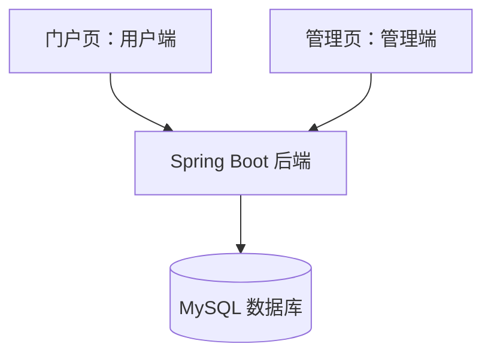

# graduation-project-starter

轻量毕业设计通用框架，面向本地演示及同类选题复用。

**当前状态：设计阶段。仓库已保存方案、架构及技术栈，尚未实现可运行代码。**

## 文档入口

- [框架方案](docs/plan.md)：目标、80% 核心功能门槛、可选业务模块、建设与验收。
- [系统与文件架构](docs/architecture.md)：门户页、管理页、后端、数据库，以及计划目录结构。
- [技术栈](docs/tech-stack.md)：前后端、数据库、登录方式和本地运行关系。

## 系统组成

门户页和管理页放在一个 Vue 工程中，以不同布局和路由组织；共用一个后端服务和一个数据库。

## 核心原则

核心功能以当前 10 个已分析项目中至少 8 个实际使用为准：登录、布局与菜单、列表查询、CRUD、请求处理、后端业务和数据库持久化。未来项目覆盖率持续统计。

上传、图表、公告、评论、订单、预约、审核等按选题加入。第一版计划实现公共底座和一个完整 CRUD 示例。

## 技术栈

Vue 3 + JavaScript + Vite + Element Plus + Vue Router + Axios + Pinia；Java 17 + Spring Boot 3.5.x + MyBatis-Plus + Spring Security Session；MySQL 8.x。具体依赖版本在实现时锁定并验证。
