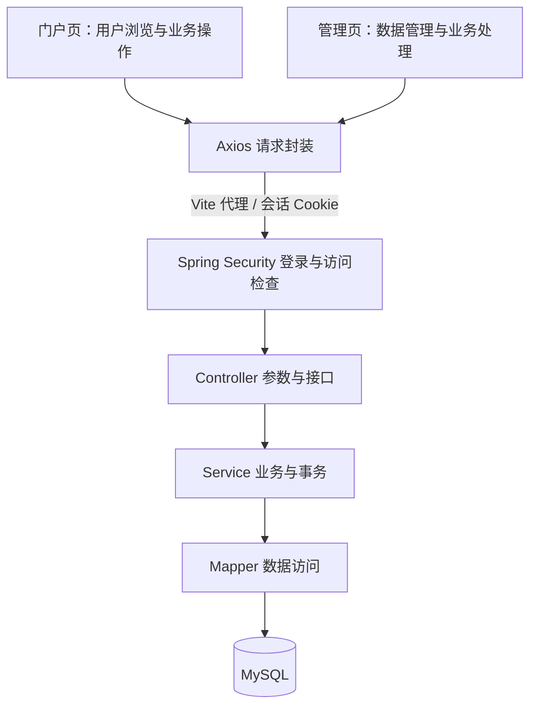

# 系统与文件架构

系统由门户页、管理页、后端服务、数据库组成。门户和管理端在同一个 Vue 工程中，以不同布局及路由组织；共用一个后端和一个数据库。



## 文件结构

```text
graduation-project-starter/
├── frontend/
│   ├── src/
│   │   ├── portal/
│   │   │   ├── layouts/       门户导航与页脚
│   │   │   └── pages/         首页、业务页面、个人中心（按需）
│   │   ├── admin/
│   │   │   ├── layouts/       侧边菜单与顶部栏
│   │   │   └── pages/         管理页面
│   │   ├── components/        共用表格、表单、弹窗
│   │   ├── api/               业务 API
│   │   ├── router/            门户与管理路由、登录路由
│   │   ├── stores/            当前用户
│   │   ├── utils/             请求封装
│   │   ├── assets/            图片与样式
│   │   ├── App.vue
│   │   └── main.js
│   ├── package.json
│   └── vite.config.js
├── backend/
│   ├── src/main/
│   │   ├── java/com/example/
│   │   │   ├── Application.java
│   │   │   ├── auth/          登录、退出、当前用户
│   │   │   ├── common/        统一返回、分页、异常
│   │   │   ├── config/        安全与应用配置
│   │   │   └── modules/
│   │   │       └── example/
│   │   │           ├── controller/
│   │   │           ├── service/
│   │   │           ├── mapper/
│   │   │           └── entity/
│   │   └── resources/
│   │       ├── application.yml
│   │       └── mapper/
│   └── pom.xml
├── database/
│   ├── schema.sql
│   └── demo-data.sql
├── docs/
│   ├── plan.md
│   ├── architecture.md
│   ├── tech-stack.md
│   ├── pages.md
│   ├── contracts.md
│   ├── database.md
│   └── implementation.md
├── AGENTS.md
└── README.md
```

以上为计划目录；当前只提交 AGENTS.md、README 与 docs，代码和数据库脚本尚未创建。

门户和管理端共享组件、账号会话和请求封装。菜单可见性由前端处理，接口访问、记录归属与业务状态由后端检查。数据库目录保存 SQL 脚本，运行数据实际保存在 MySQL 中。

后端按业务组织模块，Controller 接收请求，Service 处理规则及事务，Mapper 访问数据库。复杂查询放在 Mapper XML。普通 Service 不强制拆成接口与 Impl；DTO / VO 按输入约束和返回内容需要增加。

前端登录页固定放在 frontend/src/views/LoginPage.vue（唯一共享登录页），可按需增加 views/ErrorPage.vue 处理403/404；门户和管理业务仍分别在 portal/pages 与 admin/pages。后端模块包固定 com.example.starter.modules.example，示例表 demo_record；详见具体实施约定。
