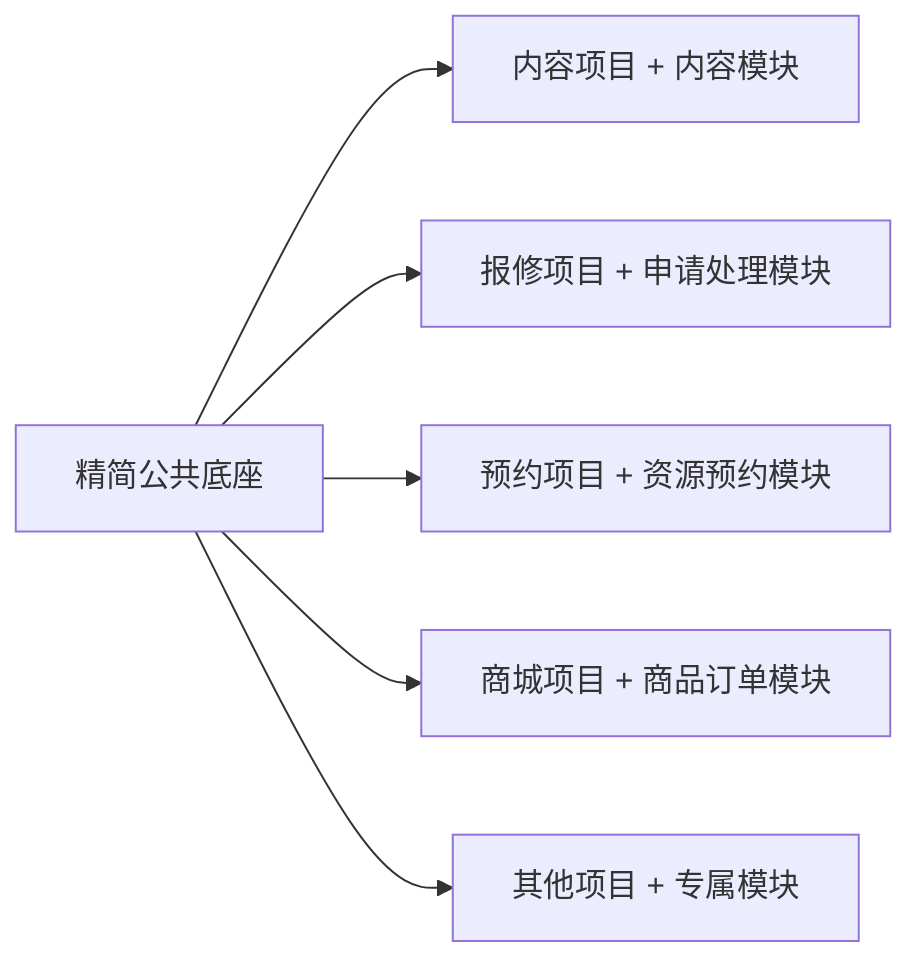

# 毕业设计通用框架方案：精简版

## 一、目标与范围

建立一个用于本地演示的轻量项目底座，减少登录、页面布局、数据管理和接口处理的重复开发。一个前端、一个后端、一个数据库；新选题复制底座，再添加需要的业务。

核心功能准入标准：在当前已分析的 10 个项目中，至少 8 个实际使用。未确认的功能不计入支持数量。未来项目的 80% 覆盖率是持续验证目标，不是当前可以保证的结论。

当前样本为蔡世杰、葛梦雨、火锅店、李璐祥、智慧社区、图书商城、刘野、王超月、祝文霞、任志豪。下面标为 10/10 的支持项目均为以上十个，依据来自本次本地静态源码分析；原项目源码及详细报告不上传到本仓库。职责相同不代表现有实现相同。

本文件保留框架范围与设计依据；第一版源码已实现，实际运行结果见 verification.md。

## 二、技术栈

| 部分 | 技术 | 选择理由 |
|---|---|---|
| 前端 | Vue 3 + JavaScript + Vite | 与现有项目接近，页面开发直接 |
| 页面组件 | Element Plus | 复用菜单、表格、表单和弹窗 |
| 路由 | Vue Router 4 | 用户与管理页面导航 |
| 请求 | Axios | API 请求与错误处理统一 |
| 共享状态 | Pinia，仅保存当前用户等必要状态 | 页面列表、表单保持局部状态 |
| 后端 | Java 17 + Spring Boot 3.5.x + Maven | 单工程、单服务，沿用现有 Java 项目经验 |
| 数据访问 | MyBatis-Plus 3.5.x Boot 3 starter | 简化普通 CRUD，复杂查询明确写 SQL |
| 登录 | Spring Security + HttpSession + BCrypt | 后端会话及访问检查，密码哈希 |
| 数据库 | MySQL 8.x | 真实保存业务数据，现有项目均使用 MySQL |

具体依赖版本在搭建时固定并验证。Spring Boot 3.5 系列需要至少 Java 17：[官方系统要求](https://docs.spring.io/spring-boot/3.5/system-requirements.html)。[Vue 官方状态管理说明](https://vuejs.org/guide/scaling-up/state-management.html)、[Element Plus](https://element-plus.org/en-US/component/overview.html)、[MyBatis-Plus](https://baomidou.com/en/) 为相关能力依据。

前端默认 5173，后端默认 8080。Vite 代理 `/api` 到后端，使用相对请求地址和会话 Cookie。请求封装处理 CSRF Token、未登录及错误反馈。会话保存在后端内存，重启后重新登录；业务数据保存在数据库。基础环境只有前端、后端、MySQL。

## 三、核心功能

| 核心能力 | 当前样本依据 | 新框架最小范围 |
|---|---|---|
| 登录与身份 | 10/10 有登录流程 | 登录、退出、当前用户、登录失效反馈 |
| 页面组织 | 10/10 有管理界面和业务页面 | 简单布局、固定菜单、路由、登录页 |
| 列表与查询 | 10/10 | 列表、搜索；统一分页约定作为列表支持 |
| CRUD 与详情 | 10/10 | 新增、修改、删除、详情；提供一个完整示例 |
| 请求和返回处理 | 10/10 有请求封装及统一返回 | API 地址、成功/失败提示、返回格式 |
| 后端业务与数据访问 | 10/10 | Controller、Service、Mapper 的明确职责 |
| 持久化与初始化 | 10/10 使用 MySQL 且有 SQL | 建表脚本、演示数据、数据库配置示例 |

“有登录”不代表原项目全部具有完善退出、后端授权或密码保护。新框架统一做后端会话检查、必要角色/记录归属检查和密码哈希；这些是正确实现登录的条件。必要参数校验、异常反馈、启动说明同样是核心能力的实现要求，不额外计为覆盖率证据。

账号角色先固定配置，例如 ADMIN、USER；新选题需要商家或教师时再增加。菜单按角色显示，后端独立检查访问权限。需要多角色关联时再增加关联表，不预先建设在线权限配置平台。

## 四、系统与目录架构

详见 [系统与文件架构](architecture.md)。系统由门户页、管理页、后端服务和数据库组成，门户与管理端同属一个前端工程。

## 五、按选题添加的模块

这些模块不默认塞进核心，也不宣称达到 80% 覆盖率。

| 模块 | 适用选题 | 必须补充的专属规则 |
|---|---|---|
| 内容、评论、收藏 | 论坛、攻略、失物招领 | 发布、审核、认领、记录归属 |
| 申请、审核、处理 | 请假、报修、社团申请 | 谁能处理、状态如何变化 |
| 资源、预约、借还 | 自习室、会议室、设备、租赁 | 冲突、可用数量、归还与费用 |
| 商品、订单、库存 | 商城、点餐、二手交易 | 价格、库存、取消、交付 |
| 题库、答卷、学习记录 | 考试、课程学习 | 提交、评分、时间与进度 |
| 房间、床位、入住 | 宿舍管理 | 分配、退宿、容量 |
| 导入、统计、图表 | 数据分析 | 字段校验和统计口径 |

上传、公告、注册、个人资料编辑、字典、图表、导入导出也按需求加入。上传使用本地目录，图表可选 ECharts，支付采用明确标注的本地模拟流程。

复用对象为代码目录、简单组件与配套 SQL；不做动态插件引擎，不把所有选题塞进万能数据表。新业务仍需实现自己的规则，不能只改项目名称。

## 六、减少重复的具体做法

1. 公共底座只有一份维护基线，项目名称、菜单、主题集中配置。
2. 提供一个真实可用的 CRUD 示例：页面、API、后端、SQL 完整配套。
3. 公共组件先支持常见列表、搜索、编辑弹窗；复杂页面单独开发。
4. 业务模块经完整演示验证后，再保存为可复用版本。
5. 项目数据和图片独立准备；业务统计有需要时从真实数据库查询。

第一版交付公共底座与一个 CRUD 示例。四类业务模块逐步积累，不要求第一版同时完成所有选题。

## 七、完成标准

- 按 README 能启动前端、后端与数据库。
- 登录、退出及刷新后的用户状态正确。
- 普通用户不能调用管理接口，不能修改他人的受限记录。
- CRUD 后刷新页面，数据仍然保存。
- 非法参数或操作有清楚反馈。
- 每个选题至少一条完整业务路径可演示。
- 演示数据覆盖主要状态，关键规则如库存不足或预约冲突得到核查。

Redis、消息队列、微服务、工作流、多租户、动态插件和代码生成平台不进入基础版。核心覆盖率随新项目重新统计；有实际至少 80% 使用证据且保持简单的能力，才考虑纳入核心。

## 第一版实施依据

页面、接口、数据及完成标准分别见 [pages](pages.md)、[contracts](contracts.md)、[database](database.md)、[implementation](implementation.md)。第一版使用中性的示例记录验证CRUD，不默认加入选题业务。
